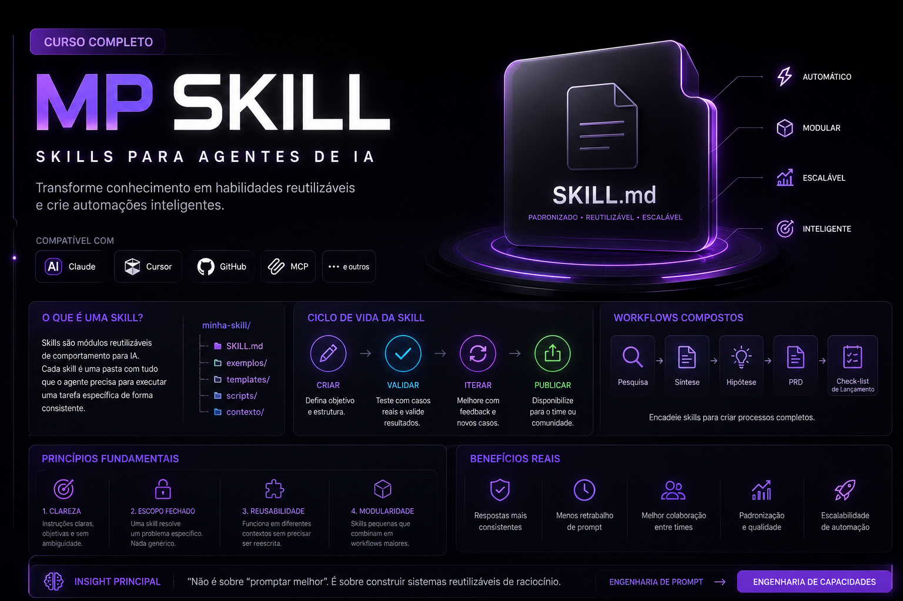

<p align="center">
  
</p>

# mp-skill — Skills para Agentes de IA (PT-BR)

<div align="center">
  
  <p><strong>Arckhé AI</strong></p>
</div>


Fork em português do repositório **[mattpocock/skills](https://github.com/mattpocock/skills)** — uma coleção de skills (slash commands e behaviors) para Claude Code, Codex e outros agentes — com tradução PT-BR e um **curso completo** sobre como usar tudo isso na prática.

> _"Não é sobre 'promptar melhor'. É sobre construir sistemas reutilizáveis de raciocínio."_

---

## 🎓 Curso: Skills For Real Engineers (PT-BR)

Curso completo em português explicando os fundamentos, a estrutura do repositório e o uso avançado das skills. **14 páginas HTML** divididas em 3 trilhas:

| Trilha | Cor | Conteúdo |
|--------|-----|----------|
| **T1 — Fundamentos** 🌱 | Emerald | Os 4 problemas que skills resolvem (desalinhamento, verbosidade, código quebrado, ball of mud). 6 módulos sobre grilling, linguagem ubíqua, TDD+diagnose, arquitetura e workflow completo. |
| **T2 — Sobre o Repositório** 📦 | Blue | Origem do projeto, filosofia, estrutura de pastas e instalação. 3 módulos. |
| **T3 — Uso Avançado** 🧩 | Purple | Composição de skills, customização e integração cross-runtime (Claude Code, Codex, MCP, CI/CD). 3 módulos. |

**👉 Acesse o curso: [inematds.github.io/mp-skill/curso-skills/](https://inematds.github.io/mp-skill/curso-skills/)**

Os arquivos do curso ficam em [`curso-skills/`](./curso-skills/).

---

## 📂 O que tem neste repositório

| Pasta | Conteúdo |
|-------|----------|
| **[`skills/`](./skills/)** | As skills propriamente ditas, organizadas em buckets: `engineering/` (10 skills de código diário), `productivity/` (workflow não-código), `misc/` (uso raro), `personal/`, `in-progress/`, `deprecated/`. |
| **[`curso-skills/`](./curso-skills/)** | Curso PT-BR em HTML estático no formato INEMA.CLUB — landing + 3 trilhas + 12 módulos. |
| **[`docs/pt-BR/`](./docs/pt-BR/)** | Tradução PT-BR do README, do CONTEXT.md e índice de todas as skills. |
| **[`CONTEXT.md`](./CONTEXT.md)** | Linguagem ubíqua do repo — termos canônicos (Issue tracker, Issue, Triage role). |
| **[`CLAUDE.md`](./CLAUDE.md)** | Convenções do projeto carregadas automaticamente pelo Claude Code. |
| **[`.claude-plugin/plugin.json`](./.claude-plugin/plugin.json)** | Manifest do plugin pra Claude Code descobrir as skills. |

### Skills disponíveis (resumo)

**Engineering** — `diagnose`, `grill-with-docs`, `triage`, `improve-codebase-architecture`, `setup-matt-pocock-skills`, `tdd`, `to-issues`, `to-prd`, `zoom-out`, `prototype`

**Productivity** — `grill-me`, `handoff`, e outras de workflow

**Misc** — skills mantidas para uso raro

Lista completa traduzida em [`docs/pt-BR/skills-pt-BR.md`](./docs/pt-BR/skills-pt-BR.md).

---

## 🚀 Instalação rápida

```bash
npx skills@latest add mattpocock/skills
```

Selecione `/setup-matt-pocock-skills` na lista, depois rode esse comando dentro do seu agente. Detalhes no [Módulo 2.3 do curso](https://inematds.github.io/mp-skill/curso-skills/curso/trilha2/modulo-2-3.html).

---

## 🌐 Versões em outros idiomas

- **🇧🇷 README em PT-BR (estendido):** [`docs/pt-BR/README.pt-BR.md`](./docs/pt-BR/README.pt-BR.md)
- **🇺🇸 README original em inglês:** seguir abaixo ↓

---

<p>
  <a href="https://www.aihero.dev/s/skills-newsletter">
    <picture>
      <source media="(prefers-color-scheme: dark)" srcset="https://res.cloudinary.com/total-typescript/image/upload/v1777382277/skills-repo-dark_2x.png">
      <source media="(prefers-color-scheme: light)" srcset="https://res.cloudinary.com/total-typescript/image/upload/v1777382277/skill-repo-light_2x.png">
      
    </picture>
  </a>
</p>

# Skills For Real Engineers

[](https://skills.sh/mattpocock/skills)

My agent skills that I use every day to do real engineering - not vibe coding.

Developing real applications is hard. Approaches like GSD, BMAD, and Spec-Kit try to help by owning the process. But while doing so, they take away your control and make bugs in the process hard to resolve.

These skills are designed to be small, easy to adapt, and composable. They work with any model. They're based on decades of engineering experience. Hack around with them. Make them your own. Enjoy.

If you want to keep up with changes to these skills, and any new ones I create, you can join ~60,000 other devs on my newsletter:

[Sign Up To The Newsletter](https://www.aihero.dev/s/skills-newsletter)

## Quickstart (30-second setup)

1. Run the skills.sh installer:

```bash
npx skills@latest add mattpocock/skills
```

2. Pick the skills you want, and which coding agents you want to install them on. **Make sure you select `/setup-matt-pocock-skills`**.

3. Run `/setup-matt-pocock-skills` in your agent. It will:
   - Ask you which issue tracker you want to use (GitHub, Linear, or local files)
   - Ask you what labels you apply to tickets when you triage them (`/triage` uses labels)
   - Ask you where you want to save any docs we create

4. Bam - you're ready to go.

## Why These Skills Exist

I built these skills as a way to fix common failure modes I see with Claude Code, Codex, and other coding agents.

### #1: The Agent Didn't Do What I Want

> "No-one knows exactly what they want"
>
> David Thomas & Andrew Hunt, [The Pragmatic Programmer](https://www.amazon.co.uk/Pragmatic-Programmer-Anniversary-Journey-Mastery/dp/B0833F1T3V)

**The Problem**. The most common failure mode in software development is misalignment. You think the dev knows what you want. Then you see what they've built - and you realize it didn't understand you at all.

This is just the same in the AI age. There is a communication gap between you and the agent. The fix for this is a **grilling session** - getting the agent to ask you detailed questions about what you're building.

**The Fix** is to use:

- [`/grill-me`](./skills/productivity/grill-me/SKILL.md) - for non-code uses
- [`/grill-with-docs`](./skills/engineering/grill-with-docs/SKILL.md) - same as [`/grill-me`](./skills/productivity/grill-me/SKILL.md), but adds more goodies (see below)

These are my most popular skills. They help you align with the agent before you get started, and think deeply about the change you're making. Use them _every_ time you want to make a change.

### #2: The Agent Is Way Too Verbose

> With a ubiquitous language, conversations among developers and expressions of the code are all derived from the same domain model.
>
> Eric Evans, [Domain-Driven-Design](https://www.amazon.co.uk/Domain-Driven-Design-Tackling-Complexity-Software/dp/0321125215)

**The Problem**: At the start of a project, devs and the people they're building the software for (the domain experts) are usually speaking different languages.

I felt the same tension with my agents. Agents are usually dropped into a project and asked to figure out the jargon as they go. So they use 20 words where 1 will do.

**The Fix** for this is a shared language. It's a document that helps agents decode the jargon used in the project.

<details>
<summary>
Example
</summary>

Here's an example [`CONTEXT.md`](https://github.com/mattpocock/course-video-manager/blob/076a5a7a182db0fe1e62971dd7a68bcadf010f1c/CONTEXT.md), from my `course-video-manager` repo. Which one is easier to read?

- **BEFORE**: "There's a problem when a lesson inside a section of a course is made 'real' (i.e. given a spot in the file system)"
- **AFTER**: "There's a problem with the materialization cascade"

This concision pays off session after session.

</details>

This is built into [`/grill-with-docs`](./skills/engineering/grill-with-docs/SKILL.md). It's a grilling session, but that helps you build a shared language with the AI, and document hard-to-explain decisions in ADR's.

It's hard to explain how powerful this is. It might be the single coolest technique in this repo. Try it, and see.

> [!TIP]
> A shared language has many other benefits than reducing verbosity:
>
> - **Variables, functions and files are named consistently**, using the shared language
> - As a result, the **codebase is easier to navigate** for the agent
> - The agent also **spends fewer tokens on thinking**, because it has access to a more concise language

### #3: The Code Doesn't Work

> "Always take small, deliberate steps. The rate of feedback is your speed limit. Never take on a task that’s too big."
>
> David Thomas & Andrew Hunt, [The Pragmatic Programmer](https://www.amazon.co.uk/Pragmatic-Programmer-Anniversary-Journey-Mastery/dp/B0833F1T3V)

**The Problem**: Let's say that you and the agent are aligned on what to build. What happens when the agent _still_ produces crap?

It's time to look at your feedback loops. Without feedback on how the code it produces actually runs, the agent will be flying blind.

**The Fix**: You need the usual tranche of feedback loops: static types, browser access, and automated tests.

For automated tests, a red-green-refactor loop is critical. This is where the agent writes a failing test first, then fixes the test. This helps give the agent a consistent level of feedback that results in far better code.

I've built a **[`/tdd`](./skills/engineering/tdd/SKILL.md) skill** you can slot into any project. It encourages red-green-refactor and gives the agent plenty of guidance on what makes good and bad tests.

For debugging, I've also built a **[`/diagnose`](./skills/engineering/diagnose/SKILL.md)** skill that wraps best debugging practices into a simple loop.

### #4: We Built A Ball Of Mud

> "Invest in the design of the system _every day_."
>
> Kent Beck, [Extreme Programming Explained](https://www.amazon.co.uk/Extreme-Programming-Explained-Embrace-Change/dp/0321278658)

> "The best modules are deep. They allow a lot of functionality to be accessed through a simple interface."
>
> John Ousterhout, [A Philosophy Of Software Design](https://www.amazon.co.uk/Philosophy-Software-Design-2nd/dp/173210221X)

**The Problem**: Most apps built with agents are complex and hard to change. Because agents can radically speed up coding, they also accelerate software entropy. Codebases get more complex at an unprecedented rate.

**The Fix** for this is a radical new approach to AI-powered development: caring about the design of the code.

This is built in to every layer of these skills:

- [`/to-prd`](./skills/engineering/to-prd/SKILL.md) quizzes you about which modules you're touching before creating a PRD
- [`/zoom-out`](./skills/engineering/zoom-out/SKILL.md) tells the agent to explain code in the context of the whole system

And crucially, [`/improve-codebase-architecture`](./skills/engineering/improve-codebase-architecture/SKILL.md) helps you rescue a codebase that has become a ball of mud. I recommend running it on your codebase once every few days.

### Summary

Software engineering fundamentals matter more than ever. These skills are my best effort at condensing these fundamentals into repeatable practices, to help you ship the best apps of your career. Enjoy.

## Reference

### Engineering

Skills I use daily for code work.

- **[diagnose](./skills/engineering/diagnose/SKILL.md)** — Disciplined diagnosis loop for hard bugs and performance regressions: reproduce → minimise → hypothesise → instrument → fix → regression-test.
- **[grill-with-docs](./skills/engineering/grill-with-docs/SKILL.md)** — Grilling session that challenges your plan against the existing domain model, sharpens terminology, and updates `CONTEXT.md` and ADRs inline.
- **[triage](./skills/engineering/triage/SKILL.md)** — Triage issues through a state machine of triage roles.
- **[improve-codebase-architecture](./skills/engineering/improve-codebase-architecture/SKILL.md)** — Find deepening opportunities in a codebase, informed by the domain language in `CONTEXT.md` and the decisions in `docs/adr/`.
- **[setup-matt-pocock-skills](./skills/engineering/setup-matt-pocock-skills/SKILL.md)** — Scaffold the per-repo config (issue tracker, triage label vocabulary, domain doc layout) that the other engineering skills consume. Run once per repo before using `to-issues`, `to-prd`, `triage`, `diagnose`, `tdd`, `improve-codebase-architecture`, or `zoom-out`.
- **[tdd](./skills/engineering/tdd/SKILL.md)** — Test-driven development with a red-green-refactor loop. Builds features or fixes bugs one vertical slice at a time.
- **[to-issues](./skills/engineering/to-issues/SKILL.md)** — Break any plan, spec, or PRD into independently-grabbable GitHub issues using vertical slices.
- **[to-prd](./skills/engineering/to-prd/SKILL.md)** — Turn the current conversation context into a PRD and submit it as a GitHub issue. No interview — just synthesizes what you've already discussed.
- **[zoom-out](./skills/engineering/zoom-out/SKILL.md)** — Tell the agent to zoom out and give broader context or a higher-level perspective on an unfamiliar section of code.
- **[prototype](./skills/engineering/prototype/SKILL.md)** — Build a throwaway prototype to flesh out a design — either a runnable terminal app for state/business-logic questions, or several radically different UI variations toggleable from one route.

### Productivity

General workflow tools, not code-specific.

- **[caveman](./skills/productivity/caveman/SKILL.md)** — Ultra-compressed communication mode. Cuts token usage ~75% by dropping filler while keeping full technical accuracy.
- **[grill-me](./skills/productivity/grill-me/SKILL.md)** — Get relentlessly interviewed about a plan or design until every branch of the decision tree is resolved.
- **[handoff](./skills/productivity/handoff/SKILL.md)** — Compact the current conversation into a handoff document so another agent can continue the work.
- **[write-a-skill](./skills/productivity/write-a-skill/SKILL.md)** — Create new skills with proper structure, progressive disclosure, and bundled resources.

### Misc

Tools I keep around but rarely use.

- **[git-guardrails-claude-code](./skills/misc/git-guardrails-claude-code/SKILL.md)** — Set up Claude Code hooks to block dangerous git commands (push, reset --hard, clean, etc.) before they execute.
- **[migrate-to-shoehorn](./skills/misc/migrate-to-shoehorn/SKILL.md)** — Migrate test files from `as` type assertions to @total-typescript/shoehorn.
- **[scaffold-exercises](./skills/misc/scaffold-exercises/SKILL.md)** — Create exercise directory structures with sections, problems, solutions, and explainers.
- **[setup-pre-commit](./skills/misc/setup-pre-commit/SKILL.md)** — Set up Husky pre-commit hooks with lint-staged, Prettier, type checking, and tests.

---

<div align="center">
  
  <p><strong>Arckhé AI</strong></p>
</div>